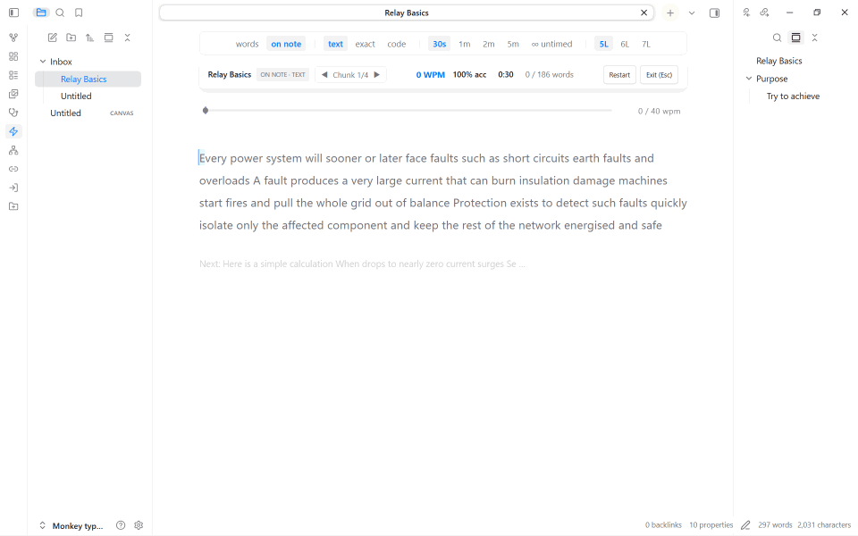
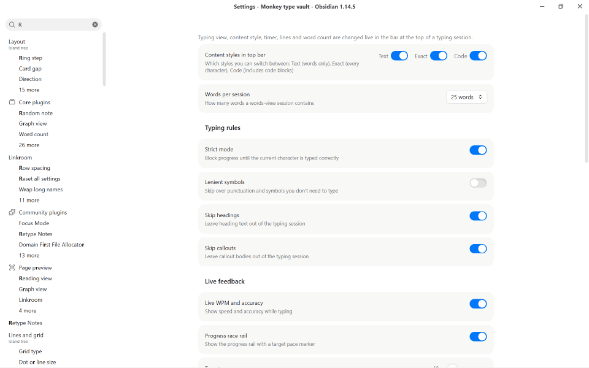

# Retype Notes

Retype your own notes to understand and remember them. Pick a note, type it back, and see your speed, accuracy and the words you keep missing. Nothing in your notes is ever changed.



## Start a session

- **Command palette:** run **Retype Notes: Type active note**.
- **Random paragraph:** run **Retype Notes: Random paragraph** to practise one paragraph from your vault.
- **File menu:** right-click a note and choose **Retype: whole note** or **Retype: random paragraph from here**.
- **Outline panel:** double-click a heading in the core Outline panel to type just that section.
- **Stop:** press `Esc` while typing to see your results. Press `Esc` again to exit. You can also run **Retype Notes: Exit active session**.

## Change the mode while typing

Everything you change often lives in the bar at the top of the typing area, so you never need to open settings mid-session.

| Control | What it does |
| --- | --- |
| **10fastfingers / on note** | Switch between the two views (below). |
| **text / exact / code** | **Text** types words only. **Exact** types every character, including punctuation. **Code** also includes code blocks. |
| **30s / 1m / 2m / 5m / untimed** | Session length. |
| **2L / 3L / 4L** (10FastFingers view) | How many lines of words are visible. |
| **5L / 6L / 7L** (on note) | How many lines are in each chunk when chunk mode is on. |

The bar hides itself once you start typing and comes back when you restart.

### Two views

- **10FastFingers:** a clean, classic word-by-word view. Type each word and press Space to move on.
- **On note:** type directly on top of your note, with its real formatting. Long notes are split into chunks, with a faint preview of the next chunk.

### Ghost typist (on note)

A quiet companion caret types forward at your target pace while you type, and the race rail shows its pace marker. Turn it off or change its colour in settings.

## Settings

Open **Settings → Community plugins → Retype Notes** (or search "Retype" in settings).



| Setting | What it does |
| --- | --- |
| Content styles in top bar | Which of Text, Exact and Code appear in the top bar. |
| Words per session | How many words a 10FastFingers session contains (all, 25, 50, 100 or 200). |
| Strict mode | A wrong character is blocked and flashes red until you type the right one. |
| Lenient symbols | Don't require exact punctuation and symbols. |
| Skip headings / callouts | Leave headings or callout bodies out of the session. |
| Live WPM and accuracy | Show speed and accuracy while typing. |
| Progress race rail | Show the slim progress rail with a pace marker. |
| Target pace | Words per minute for the pace marker and the ghost typist. |
| Chunk mode | Type long notes a few lines at a time on the note. Includes sentence breaks and a next-chunk peek. |
| Ghost typist and colour | Turn the on-note companion on or off and pick its colour. |
| Hide sidebars while typing | Collapse the side panels while you type, and restore them afterwards. |
| Outline integration | Start typing a section from the Outline panel. Includes double-click and an optional action menu. |

## Results

When a session ends you see words per minute, accuracy, raw speed, consistency and your trouble words. From there you can go to the next paragraph, retry, or drill only the words you missed.

## Mobile and other platforms

Works on Windows, macOS, Linux, iOS and Android. On phones and tablets a hidden input drives the on-note view, so the on-screen keyboard just works. Tap the note to bring the keyboard up.

## Install

- **From the community list:** Settings → Community plugins → Browse → search "Retype Notes".
- **Manually:** download `main.js`, `manifest.json` and `styles.css` from the latest release into `<vault>/.obsidian/plugins/retype-notes/`, then enable the plugin.

## Develop

```bash
npm install
npm test        # unit and stress tests
npm run build   # type-check and bundle to main.js
```

Copy `main.js`, `manifest.json` and `styles.css` into your vault's plugin folder to try a build.

## License

MIT
